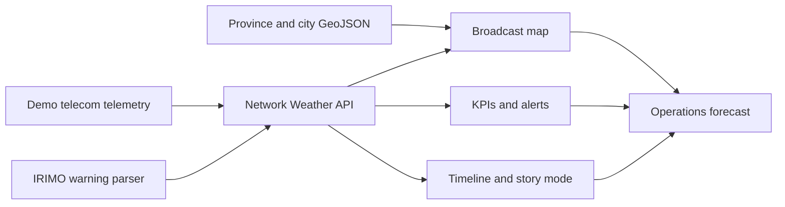

# 🌩️ Cloudy with a Chance of Downtime

> **Tonight’s forecast:** 91% utilization, scattered packet loss, and a strong chance someone asks, “Is it the network?”

**Cloudy with a Chance of Downtime** is a national telecom command center disguised as a live TV weather broadcast. It fuses radio capacity, subscribers, transmission topology, core resources, EHS readiness, incidents and real weather into one management view across Iran.

The result is a presenter-friendly dashboard that lets a NOC team explain network conditions like a weather anchor explains an approaching storm.

```text
  CURRENT CONDITIONS        TONIGHT                  OUTLOOK
  Mostly connected          Heavy congestion        Packets clearing
  Latency: comfortable      Outage cells forming    Engineers caffeinated
```

## What’s on the radar?

- 🗺️ **Iran operations map** with all 31 provinces and major cities
- 🧠 **Executive fusion queue** correlating radio, transport, core, subscribers, EHS and weather into recommended actions
- 📶 **LDP-modeled RRC/TRP views** for FDD, TDD and 5G occupancy, allocation pressure and throughput
- 🕸️ **TxTopoli-modeled transport views** for fiber/microwave links, protection, capacity, alarms, distance and loss
- 🧬 **MonRes-modeled CTO views** for Core PS, Core CS, IP, wireless/IMS, CPU, licenses, trunks and subscriber capacity
- 🦺 **EHS-modeled readiness views** for incidents, audits, PPE and corrective actions
- 🎯 **360° site digital twin** joining location, radio, subscribers, TX path, core dependency, EHS and weather exposure
- 🌦️ **Broadcast weather graphics** with animated fronts, radar cells, wind vectors, and provincial conditions
- 📡 **Telecom layers** for traffic, congestion, latency, coverage, incidents, maintenance, and technology
- ⚠️ **IRIMO warning integration** that parses official warnings and maps affected provinces
- ⏱️ **Time machine** for observed history, forecasts, playback, and severe-condition scenarios
- 📊 **Synchronized KPIs** covering availability, utilization, throughput, packet loss, and signal quality
- 🎙️ **Presenter mode** with story beats, headlines, ticker updates, and an operational briefing
- 🧑‍💻 **Audience views** for executives, NOC operators, and engineers
- ♿ **Accessible controls** with keyboard navigation, visible focus, and reduced-motion support

## See the storm

Start the app and open:

**[http://localhost:3000/network-weather/](http://localhost:3000/network-weather/)**

```bash
npm install
npm start
```

Node.js 22 or newer is required.

For maximum drama, select **Tonight**, switch to **Conditions**, and turn on **Presenter mode**. No green screen required.

## How it works



The public demo uses deterministic, sanitized mock telecom data modeled on the schemas and operating concepts of the local LDP, TxTopoli, MonRes and EHS platforms. It does not copy or publish their production records. IRIMO weather warnings are fetched and parsed separately, then associated with provinces and cities when location names are available. Live wind and condition data is corroborated through Open-Meteo, with optional OpenWeatherMap and WeatherAPI.com adapters.

| Command-center domain | Design source | Public demo state |
| --- | --- | --- |
| RRC, TRP and capacity allocations | LDP PW dashboard contract | Sanitized mock |
| Equipment and TX topology | TxTopoli inventory/topology contract | Sanitized mock |
| Core PS, Core CS, IP and wireless resources | MonRes CTO report contract | Sanitized mock |
| Incidents, audits, PPE and training | EHS operational contract | Sanitized mock |
| Weather conditions and wind | Open-Meteo + configured weather providers | Provider-backed snapshot |
| Official warnings | IRIMO | Official parsed snapshot |

### Weather source consensus

The server keeps provider credentials private and aggregates provider votes before the dashboard uses them:

- IRIMO is the official Iranian warning source.
- Open-Meteo provides live wind, gusts, temperature, humidity, and condition data without a key.
- OpenWeatherMap and WeatherAPI.com can be enabled with `OPENWEATHER_API_KEY` and `WEATHERAPI_KEY` in the server environment.
- Numeric conditions use the majority bucket. Warning decisions show the supporting providers, clear/dissenting providers, and unavailable providers separately.

Copy `.env.example` into the server environment and add the optional provider keys when available. Never put those keys in browser JavaScript or GitHub Pages assets.

No production NMS/OSS connector, real subscriber record, private topology record or production site coordinate is included in the public repository.

## Map layers

| Layer | What it answers |
| --- | --- |
| Conditions | What does the network “weather” look like? |
| IRIMO warnings | Which provinces have official weather warnings? |
| Coverage | Where is population coverage weaker? |
| Traffic | Where are the busiest network corridors? |
| Congestion | Which provinces are approaching capacity? |
| Latency | Where is response time deteriorating? |
| Incidents | Where are active operational problems concentrated? |
| Maintenance | What planned work is active or approaching? |
| Technology | Where are 4G, 5G, and 5G+ represented? |

## Verification

Run the complete MVP check:

```bash
npm run verify:network-weather-mvp
```

Individual checks are also available:

```bash
npm run verify:selfhost
npm run verify:network-weather
npm run verify:network-weather-api
npm run verify:network-weather-a11y
```

## Docker

```bash
docker build --build-arg BASE_IMAGE=node:22-bookworm-slim \
  -t cloudy-with-a-chance-of-downtime:local .

docker run --rm -p 3000:3000 \
  -v "$PWD/data:/app/data" \
  cloudy-with-a-chance-of-downtime:local
```

See [SELF-HOSTING.md](SELF-HOSTING.md) for deployment, persistence, backup, and reverse-proxy guidance.

## Presenter cheat sheet

The five-minute demo flow is documented in [docs/network-weather-demo.md](docs/network-weather-demo.md). It covers the calm opening, rising evening load, severe 21:00 forecast, maintenance impact, and overnight recovery.

## Data disclaimer

Telecom measurements in this repository are illustrative dummy data created for an MVP presentation. Observed and forecast states are explicitly labeled, and timestamps use `Asia/Tehran`.

---

Built for the moments when the network is not *down*—it is merely experiencing **severe atmospheric packet conditions**.
