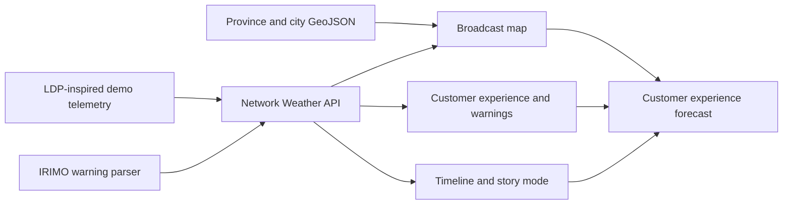

# 🌩️ Cloudy with a Chance of Downtime

> **Tonight’s forecast:** 91% utilization, scattered packet loss, and a strong chance someone asks, “Is it the network?”

**Cloudy with a Chance of Downtime** is an operator weather desk disguised as a live TV weather broadcast. It combines provider-backed weather with an LDP-inspired model of radio demand and traffic to show where mobile service may feel great, good, busy, or limited across Iran—and what the operator should do next.

The result is an operational dashboard that explains mobile experience the way a weather anchor explains the day: what it feels like now, where conditions may change, who owns the response, and when the next decision is due.

```text
  CURRENT CONDITIONS        TONIGHT                  OUTLOOK
  Mostly connected          Heavy congestion        Packets clearing
  Latency: comfortable      Outage cells forming    Engineers caffeinated
```

## What’s on the radar?

- 🗺️ **Iran customer-experience map** with all 31 provinces and major cities
- 🎛️ **Operator shift bar** for source freshness, open priorities, and potential customer impact
- 🚨 **Prioritized action queue** with owner, response target, recommended action, and local acknowledgement state
- 🔗 **Synchronized workflow** connecting queue rows, map markers, and regional detail
- 🙂 **Plain-language service outlook** showing great, good, busy, and limited areas
- 📶 **LDP-inspired demand and speed views** that translate RRC and TRP into what customers may feel
- 🧭 **Regional cards** for expected experience, typical speed, availability, and people who may notice a change
- 🌦️ **Broadcast weather graphics** with animated fronts, radar cells, wind vectors, and provincial conditions
- 📡 **Four focused map modes** for live weather, customer experience, demand, and speed
- ⚠️ **IRIMO warning integration** that parses official warnings and maps affected provinces
- ⏱️ **Time machine** for observed history, forecasts, playback, and severe-condition scenarios
- 📊 **Optional network details** for availability, RRC-style utilization, TRP-style throughput, packet loss, and signal quality
- 🎙️ **TV mode** with story beats, headlines, ticker updates, and a customer-friendly briefing
- 🧑‍💻 **Progressive detail** from customer language to service and network views
- ♿ **Accessible controls** with keyboard navigation, visible focus, and reduced-motion support

## See the storm

Start the app and open:

**[http://localhost:3000/network-weather/](http://localhost:3000/network-weather/)**

```bash
npm install
npm start
```

Node.js 22 or newer is required.

For maximum drama, select **Tonight**, switch to **Conditions**, and turn on **Presenter mode**. No green screen required.

## How it works



The public demo uses deterministic, sanitized mock radio-demand and traffic data inspired by LDP concepts. It does not copy or publish production records, subscriber records, exact sites, or internal topology. IRIMO weather warnings are fetched and parsed separately, then associated with provinces and cities when location names are available. Live wind and condition data is corroborated through Open-Meteo, with optional OpenWeatherMap and WeatherAPI.com adapters.

| Customer-facing domain | Design source | Public demo state |
| --- | --- | --- |
| Radio demand and typical speed | LDP RRC/TRP concepts | Sanitized mock |
| Customer experience and availability | Derived presentation model | Sanitized mock |
| Weather conditions and wind | Open-Meteo + configured weather providers | Provider-backed snapshot |
| Official warnings | IRIMO | Official parsed snapshot |

### Weather source consensus

The server keeps provider credentials private and aggregates provider votes before the dashboard uses them:

- IRIMO is the official Iranian warning source.
- Open-Meteo provides live wind, gusts, temperature, humidity, and condition data without a key.
- OpenWeatherMap and WeatherAPI.com can be enabled with `OPENWEATHER_API_KEY` and `WEATHERAPI_KEY` in the server environment.
- Numeric conditions use the majority bucket. Warning decisions show the supporting providers, clear/dissenting providers, and unavailable providers separately.

Copy `.env.example` into the server environment and add the optional provider keys when available. Never put those keys in browser JavaScript or GitHub Pages assets.

No production NMS/OSS connector, real subscriber record, private topology record or production site coordinate is included in the public repository.

## Map views

| Layer | What it answers |
| --- | --- |
| Live weather | What are provider-backed weather and observed wind doing now? |
| Customer experience | Where should service feel great, good, busy, or limited? |
| Demand | Where is LDP-inspired RRC pressure rising? |
| Speed | What typical LDP-inspired TRP throughput may customers experience? |
| IRIMO warnings | Which provinces have official weather warnings? |

## Verification

Run the complete MVP check:

```bash
npm run verify:network-weather-mvp
```

Individual checks are also available:

```bash
npm run verify:selfhost
npm run verify:network-weather
npm run verify:network-weather-api
npm run verify:network-weather-a11y
```

## Docker

```bash
docker build --build-arg BASE_IMAGE=node:22-bookworm-slim \
  -t cloudy-with-a-chance-of-downtime:local .

docker run --rm -p 3000:3000 \
  -v "$PWD/data:/app/data" \
  cloudy-with-a-chance-of-downtime:local
```

See [SELF-HOSTING.md](SELF-HOSTING.md) for deployment, persistence, backup, and reverse-proxy guidance.

## Presenter cheat sheet

The five-minute demo flow is documented in [docs/network-weather-demo.md](docs/network-weather-demo.md). It covers the calm opening, rising evening load, severe 21:00 forecast, maintenance impact, and overnight recovery.

## Data disclaimer

Telecom measurements in this repository are illustrative dummy data created for an MVP presentation. Observed and forecast states are explicitly labeled, and timestamps use `Asia/Tehran`.

---

Built for the moments when the network is not *down*—it is merely experiencing **severe atmospheric packet conditions**.
